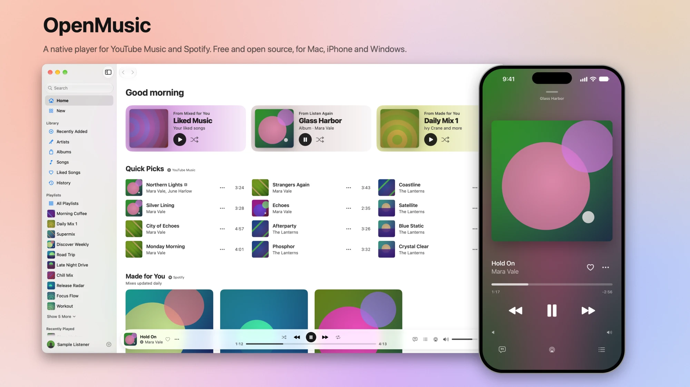
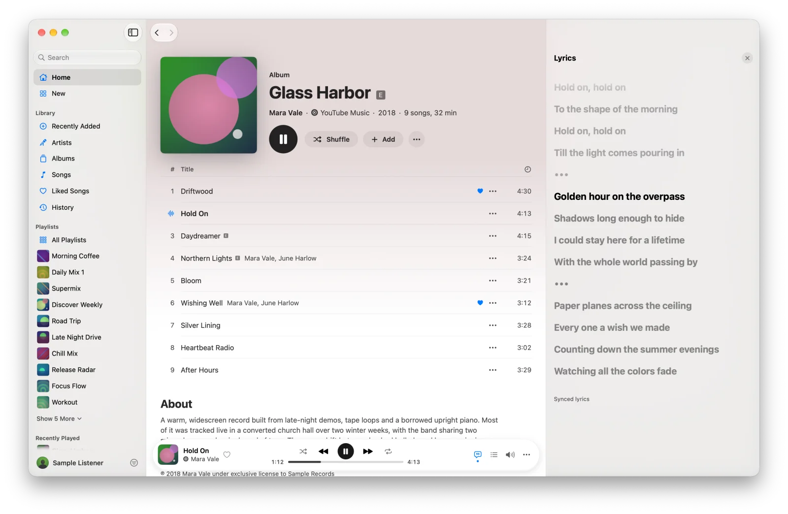
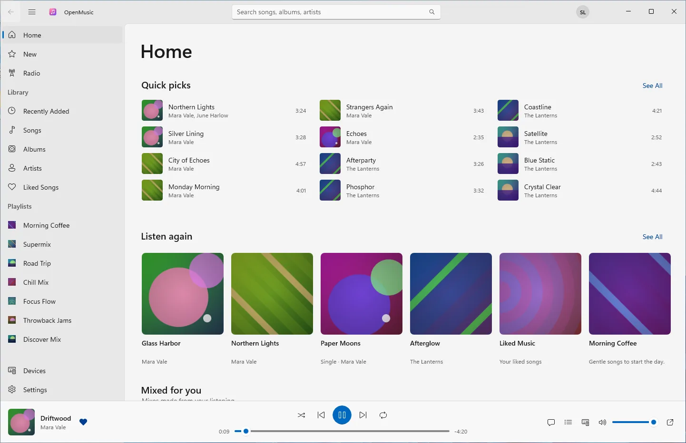
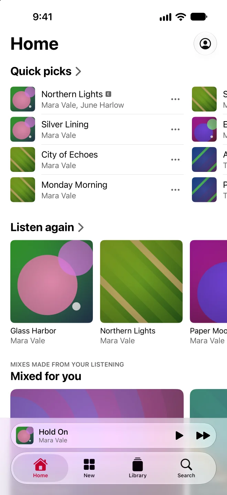
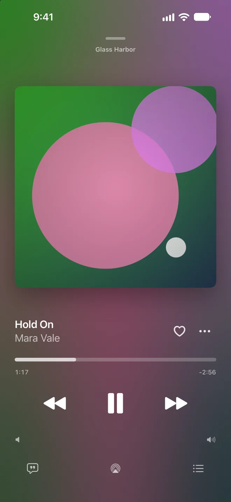

  

<h1 align="center">OpenMusic</h1>

  One native player for your YouTube Music and Spotify libraries, on Mac, iPhone and Windows. 
  Free and open source. In beta.

  
  
  
  

<picture>
  <source media="(prefers-color-scheme: dark)" srcset="docs/images/hero-dark.webp">
  
</picture>

OpenMusic was called Medley before its first public release.

## Download

| Platform | How to get it |
| --- | --- |
| **Windows** | Download `OpenMusic-<version>-windows-x64.zip` from [Releases](https://github.com/opencoredev/openmusic/releases), extract it, and run `OpenMusic.exe` in the `OpenMusic` folder. Needs Windows 10 version 2004 or later, or Windows 11, on x64. Google sign-in needs the [WebView2 runtime](https://developer.microsoft.com/microsoft-edge/webview2/), which Windows 11 already has. |
| **Mac** | No signed build is published yet: [build it from source](CONTRIBUTING.md#mac). Needs macOS 15 or later on an Apple silicon Mac. |
| **iPhone** | Not on the App Store, and releases include no `.ipa` yet: [build it with Xcode](iOS/README.md#install-on-your-iphone) and your own Apple ID. Needs iOS 26 or later. |

The Windows build isn't code-signed, so the first launch shows SmartScreen's "Windows protected your PC": click **More info**, then **Run anyway**.

## Why use it

- **Both services in one place.** Search, browse and play YouTube Music and Spotify side by side, with one library, one queue, Play Next, shuffle, repeat and autoplay radio when the queue runs out.
- **Native on each platform.** SwiftUI on the Mac and iPhone, WinUI 3 on Windows. No web views for the interface, and no CPU use while paused.
- **Synced lyrics and system controls.** Lyrics follow the song, from YouTube Music first and [LRCLIB](https://lrclib.net) second. Media keys, Control Center, the lock screen, AirPods and the Windows media flyout all work.
- **Move playback between devices.** Continue on your iPhone what your Mac was playing, send playback to another device, or control one from another. Optional, end-to-end encrypted, and you can run your own server.

## What works where

| | Mac | iPhone | Windows |
| --- | --- | --- | --- |
| YouTube Music: browse, search, library, playback | Yes | Yes | Yes |
| YouTube Music signed out | Browse and play | Browse and play | Browse and play |
| Spotify | Remote control (below) | Remote control (below) | Not yet |
| Synced lyrics | Yes | Yes | Yes |
| Sync and handoff between devices | Yes | Yes | Yes |
| Sound Check and crossfade | Yes | Yes | Not yet |

Spotify works as a remote control: OpenMusic browses Spotify, keeps the queue and sends each song to Spotify, and the audio plays in the Spotify app or on a Spotify Connect device.

- On a Mac with the Spotify app installed, OpenMusic plays through it, with a Free or Premium account. macOS asks once whether OpenMusic may control Spotify.
- Spotify Connect (another device, a speaker, or the iPhone) needs Spotify Premium and Spotify open on that device. The iPhone app plays Spotify only this way.

## Screenshots

<picture>
  <source media="(prefers-color-scheme: dark)" srcset="docs/images/mac-lyrics-dark.webp">
  
</picture>

<picture>
  <source media="(prefers-color-scheme: dark)" srcset="docs/images/windows-home-dark.webp">
  
</picture>

  <picture>
    <source media="(prefers-color-scheme: dark)" srcset="docs/images/ios-home-dark.webp">
    
  </picture>
  &nbsp;&nbsp;
  <picture>
    <source media="(prefers-color-scheme: dark)" srcset="docs/images/ios-nowplaying-dark.webp">
    
  </picture>

The artists, albums and covers in these images are made up: they come from the apps' sample data.

## Getting started

1. **Open OpenMusic.** The first launch walks you through signing in to your services and, optionally, to sync. You can skip any step and find it later in Settings.
2. **Sign in to YouTube Music** with Google in the window OpenMusic opens. Everything except your library works signed out too, playback included.
3. **Connect Spotify** (Mac and iPhone): sign in on Spotify's own page (in your browser on the Mac, in a sheet on the iPhone) and you're back in OpenMusic. [How Spotify sign-in works](docs/spotify.md), and what to do if it stops working.
4. **Optional: sign in to sync** with an email code, Apple or Google, on each device you want to connect. A new device gets your sync key after you approve it on a device that has it, by comparing a six-digit code.

If something doesn't work, see [Troubleshooting](docs/troubleshooting.md).

## Sync and privacy

What you play, your queue, your searches, your settings and your service sign-ins are encrypted on your devices with a key the server never has. The server sees your devices, their names, and when each one plays, pauses or seeks, so it can tell when and for how long you listen, but not what. The hosted sync server is a beta run by the OpenMusic maintainers: it is limited, may show a sign-in banner from its sign-in provider, and may be reset, so [running your own server](docs/self-hosting.md) is the stable option.

Details: [Privacy](docs/privacy.md) and [what the server can see](docs/sync-design.md#what-the-server-can-see). Sync is optional; OpenMusic works without an account.

## Build and contribute

[CONTRIBUTING.md](CONTRIBUTING.md) has the repository map and the commands for each platform from a fresh clone. The [docs index](docs/README.md) lists every guide and design document. Security problems: see [SECURITY.md](SECURITY.md).

## Known limits

- YouTube Music streams are AAC at about 128 kbps. Premium's 256 kbps streams aren't used.
- OpenMusic relies on unofficial YouTube Music and Spotify interfaces. When YouTube changes how playback works, songs can stop playing until OpenMusic is updated.
- Spotify plays only through the Spotify app or Spotify Connect, never inside OpenMusic, and isn't available on Windows yet.
- Mac and iPhone builds from source aren't notarized. On the Mac, sign-ins stay across rebuilds only with the local signing identity described in [CONTRIBUTING.md](CONTRIBUTING.md#mac).
- The Windows app isn't code-signed. Releases are x64 only; ARM64 builds from source.

## Disclaimer

OpenMusic is an unofficial app, not affiliated with, endorsed by or sponsored by Google, YouTube or Spotify. It uses unofficial interfaces to those services, which can change or stop working at any time and may conflict with their terms of service. Use it at your own risk. OpenMusic streams music for playback only and never downloads or saves it. YouTube, YouTube Music and Spotify are trademarks of their owners.

## Acknowledgements

- [librespot](https://github.com/librespot-org/librespot), [ncspot](https://github.com/hrkfdn/ncspot) and [spotify_player](https://github.com/aome510/spotify-player), whose use of Spotify's desktop client ID for sign-in OpenMusic follows.
- [yt-dlp](https://github.com/yt-dlp/yt-dlp), whose work on YouTube's player clients and their versions guides OpenMusic's stream resolution.
- [LRCLIB](https://lrclib.net), the free synced-lyrics database OpenMusic uses when YouTube Music has no lyrics.

## License

MIT. See [LICENSE](LICENSE).
